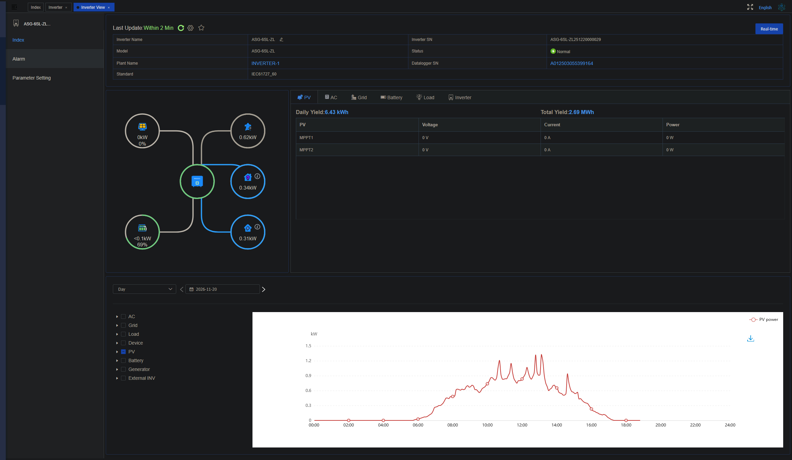

After installing a residential solar setup powered by an **Auxsol** brand inverter, I hit a common smart-home roadblock: the hardware relies on a closed-source cloud ecosystem (auxsolcloud.com) with no native local API or official Home Assistant integration.

While the vendor mobile and web apps for basic visibility and controls, keeping energy data trapped inside a proprietary portal prevents real-time home automation, custom energy dashboards, and automated battery management based on utility Time-of-Use (ToU) schedules.

Taking inspiration from an existing community implementation built on Django by [thefarrukh](https://github.com/thefarrukh/auxsolcloud)  (cheers bud!), I decided to engineer a lightweight, free, and open-source alternative—[Auxol Cloud FastAPI](https://github.com/lemeow125/auxsolcloud)—designed specifically for low-overhead self-hosting and seamless Home Assistant ingestion.

## The Trade-Offs

Farrukh built around a system at scale where one could add multiple inverters. I saw it from my lens at home with one.

The middleware bridge solution required a balance on developer ergonomics/velocity, runtime footprint, and maintainability:

- **FastAPI vs. Heavyweight Frameworks:** While the original community project proved the concept using Django and Celery, a full-stack framework with an ORM, admin panel, and heavy boilerplate is overkill for a stateless API proxy. Moving to **FastAPI** drastically reduced memory overhead, improved async I/O performance for cloud polling, and provided automatic OpenAPI/Swagger documentation out of the box.
- **Cloud Polling vs. Hardware Hacking:** Rather than voiding warranties by tapping directly into local RS485/Modbus serial ports, wrapping the upstream Auxsol Cloud endpoints (eu.auxsolcloud.com/auxsol-api) offered a safe, non-invasive integration path that works out of the box for any Auxsol owner.
- **Read-Only Telemetry vs. Active Control:** Exposing passive metrics is straightforward, but true energy optimization requires write access. I prioritized exposing **Time-of-Use (ToU) control endpoints** alongside telemetry so Home Assistant automations can dynamically adjust charging/discharging windows rather than just passively logging data.
- **Git-Native API Testing (Bruno) vs. Manual Verification:** Because upstream vendor APIs can change without notice, relying on manual checks is risky—especially when write endpoints modify inverter schedules. Instead of bloated GUI clients, I used **Bruno** (a plain-text, Git-friendly API test suite) to automate end-to-end contract verification before and after every deployment.

## Execution

I built the service on modern Python tooling (**Python 3.13+** and **`uv`**) to ensure fast dependency resolution and reproducible deployments:

- **Stateless API Proxy Layer:** Engineered clean REST endpoints in FastAPI to handle authentication against the Auxsol Cloud API, translating proprietary upstream payloads into structured JSON ready for Home Assistant REST sensors and automations.
- **Telemetry & Time-Series Endpoints:** Exposed granular endpoints for real-time inverter status (live generation, load, battery state), historical time-series production analytics, and detailed inverter reports.
- **Time-of-Use (ToU) Control Exposure:** Surfaced inverter configuration endpoints to allow programmatic control over Time-of-Use schedules, enabling automated peak-shaving and tariff-based battery rules directly from Home Assistant.
- **Two-Stage Automated API Testing (Bruno):** Built a version-controlled **Bruno** test collection covering every endpoint:
    - **Pre-Deployment Gate:** Spins up an ephemeral, isolated test environment to run the full Bruno suite against every route, catching regressions or upstream schema shifts before code ever ships.
    - **Post-Deployment Verification:** Executes automated smoke tests against the live deployed container to verify production health, authentication, and network connectivity immediately after release.
- **Zero-Friction Containerization:** Packaged the application with Docker and Docker Compose using environment-driven configuration (`.env` for credentials, serial numbers, and regional API base URLs), allowing other self-hosters to spin up the bridge in seconds.

## Outcome

- **Full Home Assistant Integration:** Successfully liberated proprietary solar data into a local smart-home ecosystem, enabling unified energy monitoring and automated Time-of-Use battery orchestration.
- **Lightweight Self-Hosted Footprint:** Replaced heavyweight framework overhead with a lean, asynchronous Python 3.13 + FastAPI service managed via `uv` and Docker.
- **Open-Source Contribution:** Released the project as free, open-source software with a streamlined Quick Start setup, giving other Auxsol inverter owners a drop-in solution to reclaim control over their solar hardware.